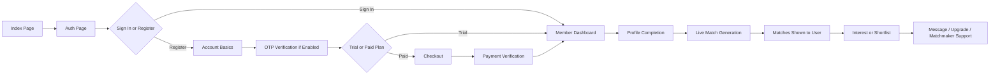
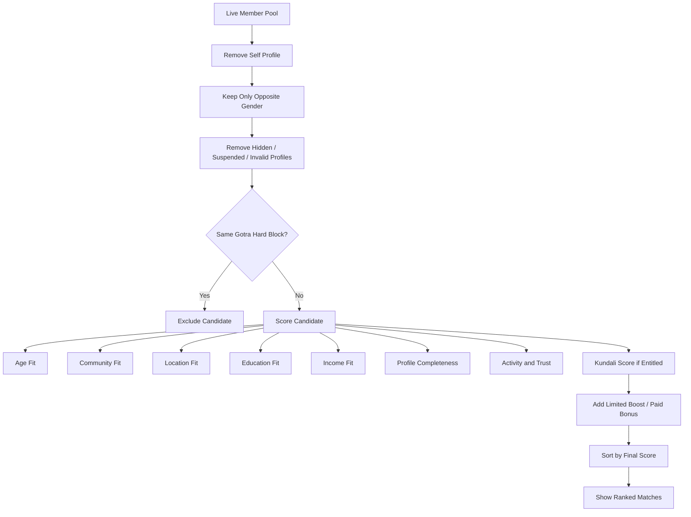
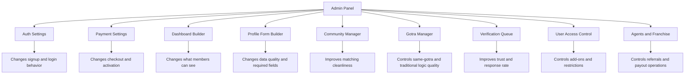
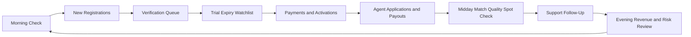
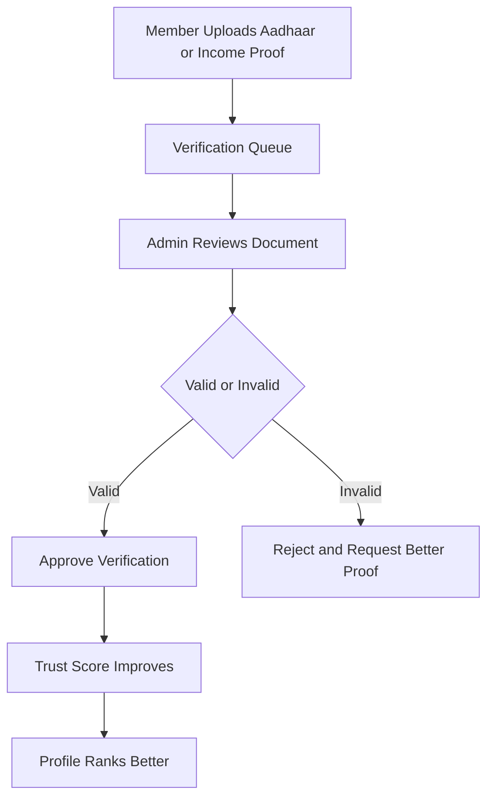
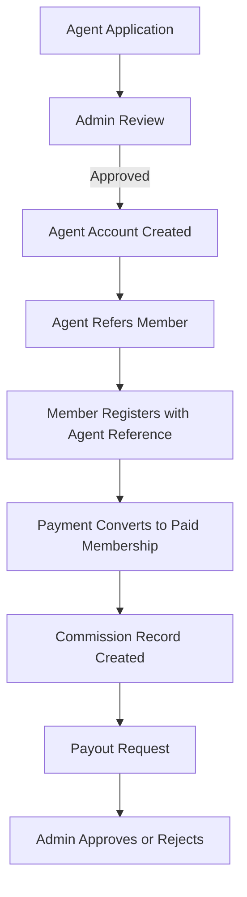

# Parichayam Visual Flow Diagrams

These diagrams are designed for admin and business-owner training.

## 1. End-to-End User Journey

## 2. Matchmaking Engine Logic

## 3. Admin Controls and Business Impact

## 4. Daily Operations Loop

## 5. Verification Flow

## 6. Agent Referral Flow

